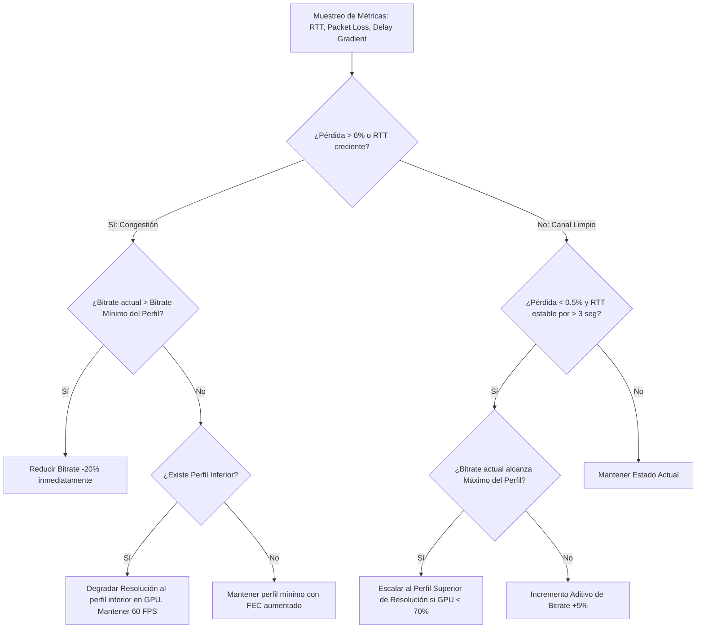
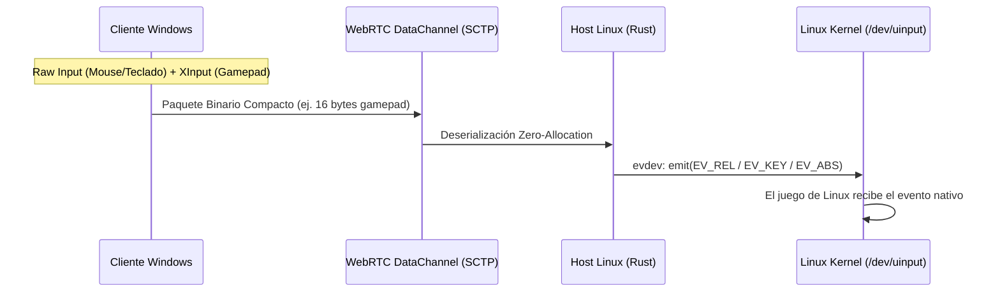

# DECISIONES DE ARQUITECTURA Y DISEÑO TÉCNICO: GAMESTREAM-RS
**Proyecto:** Alternativa de código abierto a Parsec con Host nativo en Linux (Rust) y Clientes Windows  
**Fecha:** Noviembre 2026  
**Autor:** Equipo de Ingeniería de Sistemas y Streaming de Ultra Baja Latencia  
**Estado:** Propuesta Fase 0 (Pendiente de Aprobación)

---

## 1. RESUMEN EJECUTIVO Y DIRECTRICES DE DISEÑO

El objetivo primordial es construir un sistema de transmisión de juegos en tiempo real con latencia extremo a extremo menor a 30 ms en LAN y menor a 60 ms en WAN, priorizando **60 FPS estables e ininterrumpidos** por encima de la fidelidad gráfica.

El sistema debe operar eficientemente desde hardware de gama baja extremo (**Intel HD 3000 / Sandy Bridge de 2011**) hasta GPUs contemporáneas (Intel Arc, AMD Radeon RDNA/GCN, NVIDIA Turing/Ada Lovelace).

### Principios Innegociables
1. **60 FPS Invariables:** El frame rate no se negocia. Si hay congestión o falta de capacidad de cómputo, el pipeline degrada resolución o bitrate, jamás la cadencia de cuadros.
2. **Zero-Copy / Min-Copy Pipeline:** Minimizar transferencias de memoria entre VRAM y RAM del sistema.
3. **Escalado en Origen:** Cualquier cambio de resolución se realiza en GPU antes de pasar al encoder de video, liberando ciclos de compresión.
4. **Manejo de Errores Explícito:** Cero llamadas a `.unwrap()` o panics en rutas de ejecución crítica.

---

## 2. ANÁLISIS DETALLADO Y DECISIONES TÉCNICAS

---

### A. CÓDEC DE VIDEO

#### Tabla Comparativa de Códecs

| Códec | Soporte HW Host (Intel HD 3000 - Sandy Bridge) | Soporte HW Host (AMD / NVIDIA / Intel Reciente) | Soporte HW Cliente Windows (Legacy Intel HD 3000 / D3D 10.1) | Costo de CPU (Fallback Software a 720p60) | Latencia de Pipeline (HW) | Estado de Patentes / Licencias |
| :--- | :--- | :--- | :--- | :--- | :--- | :--- |
| **H.264 (AVC)** | **SÍ (VA-API `i965` - Constrained Baseline)** | **SÍ (VA-API, NVENC, AMF universal)** | **SÍ (DXVA2 / D3D11VA universal)** | **Moderado (~25-35% en 2 cores con x264 ultrafast)** | **Ultra baja (< 2-4 ms por cuadro)** | Licencias de distribución de binarios cubiertas por decodificadores del SO y openh264/Mesa. |
| **HEVC (H.265)** | **NO** (0% soporte en Sandy Bridge) | SÍ (Desde Skylake / GTX 950 / RX 400+) | **NO** en GPUs antiguas (requiere Skylake+) | **Inviable** (>90% CPU en 2 cores, no alcanza 60 FPS) | Muy baja (< 3-5 ms) | Alto riesgo de regalías (MPEG LA / HEVC Advance / Velos). |
| **VP8** | **NO** en hardware Sandy Bridge | Limitado en GPUs modernas | **NO** en DXVA2 antiguo (decode en CPU) | **Alto** en CPU antigua a 60 FPS | Moderada (3-6 ms) | Libre de regalías (Google / WebM). |
| **VP9** | **NO** en hardware Sandy Bridge | SÍ en hardware medio/reciente | **NO** en DXVA2 antiguo (decode en CPU) | **Inviable** a 60 FPS en CPUs Sandy Bridge | Moderada-Baja (4-8 ms) | Libre de regalías (Google / WebM). |
| **AV1** | **NO** en hardware Sandy Bridge | Solo en GPUs 2022+ (Arc, RTX 40, RX 7000) | **NO** en hardware antiguo | **Completamente inviable** en CPUs antiguas | Muy baja en GPUs nuevas, pero nula compatibilidad legacy | Libre de regalías (AOMedia). |

#### Recomendación Justificada: H.264 (AVC) Obligatorio
El códec base innegociable debe ser **H.264**. Intel HD 3000 posee la primera generación de Intel Quick Sync Video (Gen6 execution units), cuyo controlador VA-API en Linux (`i965_drv_video.so`) expone exclusivamente codificación para `VAProfileH264ConstrainedBaseline` y `VAProfileH264Main`. En el cliente Windows con GPUs antiguas, DXVA2 solo garantiza aceleración completa para H.264. Cualquier otro códec obligaría al host o cliente a decodificar en software, saturando la CPU e impidiendo mantener 60 FPS.

#### Configuración Precisa del Encoder H.264 para Streaming Interactivo
1. **Perfil:** `Constrained Baseline Profile` (CBP, nivel 3.1 a 4.1).
   * *Justificación:* Elimina por especificación los B-frames (cero reordenamiento de cuadros), utiliza entropía CAVLC/CABAC de bajo cómputo y garantiza que cualquier decodificador antiguo (DXVA2 en Windows o WebRTC en navegador) procese los NAL units sin retraso de sincronización.
2. **Cero B-Frames (`bframes = 0`):**
   * *Justificación:* Los B-frames requieren conocer cuadros futuros para comprimir, lo cual añade un retardo de buffer de presentación de 1 a 3 frames (16.6 ms a 50 ms). En streaming interactivo de juegos esto es inaceptable.
3. **GOP e Intra-Refresh vs Keyframes Periódicos:**
   * *Problema de los Keyframes (IDR) periódicos:* Un fotograma I completo ocupa típicamente entre 5 y 10 veces más bytes que un fotograma P. Transmitir un I-frame cada 1 o 2 segundos crea picos de bitrate masivos que saturan los buffers del router doméstico, provocando tirones de latencia (*bufferbloat jitter*).
   * *Estrategia Elegida:*
     * **Intra-Refresh Cíclico (Cyclic Intra Macroblock / Slice Refresh):** Si el encoder de hardware lo permite, cada cuadro sustituye una franja vertical u horizontal de macrobloques con bloques Intra, refrescando la pantalla entera a lo largo de 30-60 cuadros sin picos de ancho de banda.
     * **On-Demand Keyframes (Feedback PLI/FIR):** En hardware que no exponga intra-refresh en VA-API (como Sandy Bridge `i965`), se configura un GOP infinito (`gop_size = 0` o un valor de varios minutos) y **solo se genera un cuadro IDR si el cliente notifica pérdida irrecuperable de paquetes** mediante un mensaje RTCP PLI (Picture Loss Indication) o Full Intra Request (FIR).
4. **Control de Tasa (Rate Control):**
   * Modo **Low-Latency CBR** (Constant Bitrate) con un tamaño de buffer VBV ultra pequeño: `vbv-bufsize` igual al tamaño de 1 cuadro (~16.6 ms de bitrate nominal) y `vbv-maxrate = target_bitrate`. Esto fuerza al encoder a limitar estrictamente el tamaño de cada frame individual.
5. **Preset de Fallback por Software (`x264`):**
   * En caso de no detectar encoder por hardware funcional, se invoca `libx264` con `preset = ultrafast` y `tune = zerolatency`, desactivando lookahead, b-frames, sub-me exhaustivo y multi-reference frames.

---

### B. PERFILES DE RESOLUCIÓN Y BITRATE

#### Tabla de Perfiles a 60 FPS Fijos

| Perfil | Resolución | Relación de Aspecto | Píxeles / Cuadro | Carga Relativa vs 720p | Bitrate Mínimo (Congestión) | Bitrate Recomendado | Bitrate Máximo (LAN / Fibra) | Escenario de Uso |
| :--- | :--- | :--- | :--- | :--- | :--- | :--- | :--- |
| **720p60** | 1280 x 720 | 16:9 | 921,600 | 100% | 2,500 kbps | 4,500 kbps | 7,500 kbps | Red LAN / Conexión estable > 10 Mbps |
| **Sub-HD 1** | 1024 x 576 | 16:9 | 589,824 | 64.0% | 1,800 kbps | 3,000 kbps | 5,000 kbps | Perfil "Estilo PS3", ideal para Intel HD 3000 |
| **Sub-HD 2** | 854 x 480 | 16:9 | 409,920 | 44.5% | 1,200 kbps | 2,000 kbps | 3,500 kbps | Conexiones ADSL / WiFi inestable |
| **Sub-HD 3** | 640 x 360 | 16:9 | 230,400 | 25.0% | 600 kbps | 1,200 kbps | 2,000 kbps | Fallback extremo por congestión severa |
| **Retro / 4:3**| 640 x 480 | 4:3 | 307,200 | 33.3% | 800 kbps | 1,500 kbps | 2,500 kbps | Juegos retro / monitores antiguos |

*Nota Técnica:* Todas las resoluciones son múltiplos de 16 (macroblock-aligned), lo que evita artefactos de padding y errores de hardware en codificadores de silicio más antiguos.

#### Lógica de Adaptación Dinámica (Dynamic Rate & Resolution Adaptation)
La adaptación opera en un bucle continuo de realimentación (cada 200 ms) alimentado por métricas de red (TWCC o RTCP Receiver Reports):



* **Prioridad Inmutable:** Si el canal se satura, el sistema desciende de resolución (ej. de 720p a 576p, o de 576p a 480p) **manteniendo siempre los 60 FPS**. El ojo humano tolera una pérdida temporal de nitidez en movimiento, pero el input lag y el stutter a 30 FPS destruyen la jugabilidad.
* **Reescalado en Origen:** El host captura el escritorio nativo y realiza el downscaling directamente en GPU mediante **VA-API VPP (`VAEntrypointVideoProc`)** o EGL/OpenGL. La CPU no toca los píxeles durante el escalado.

---

### C. CÓDEC DE AUDIO: OPUS

#### Justificación de Parámetros de Audio
* **Códec:** **Opus (RFC 6716)**. Es el estándar de facto universal para audio interactivo de bajísima latencia.
* **Tamaño de Frame:** **10 ms (480 muestras a 48 kHz estéreo)**.
  * *2.5 ms:* Demasiado overhead de cabeceras de red (400 paquetes UDP/s; el peso de cabeceras IP+UDP+RTP supera al audio útil).
  * *5 ms:* 200 paquetes/s. Aceptable, pero duplica el costo de interrupciones de red en clientes modestos sin beneficio perceptible.
  * *10 ms (Recomendado):* 100 paquetes/s. El retraso algorítmico es de solo 10 ms (menos de un cuadro de video a 60 FPS que dura 16.6 ms), manteniendo una sobrecarga de red insignificante (~3.2 kbps de cabeceras).
  * *20 ms:* Típico en VoIP, pero añade 20 ms de retardo estricto, superando el límite de un cuadro a 60 FPS.
* **Bitrate:** **96 kbps estéreo**. Provee calidad transparente para música compleja, disparos y efectos sonoros de juegos sin desperdiciar ancho de banda.
* **Modo de Aplicación:** `OPUS_APPLICATION_RESTRICTED_LOWDELAY`.
  * *Crucial:* A diferencia de `OPUS_APPLICATION_AUDIO`, este modo desactiva el buffer de lookahead interno de libopus y evita la conmutación de modelos voz/música con ventanas de retardo, garantizando latencia algorítmica pura igual a la duración del frame.
* **In-Band FEC (Forward Error Correction):** **Activado**. En caso de pérdida de un paquete, libopus decodifica el frame perdido con datos redundantes empaquetados en el siguiente paquete con un incremento mínimo de bitrate (+10-15%), evitando retransmisiones por red.
* **DTX (Discontinuous Transmission):** **Desactivado**. Los juegos tienen sonido ambiental continuo o pausas rápidas; activar DTX introduce saltos de reactivación perceptibles (*comfort noise switching clicks*).
* **Costo de CPU:** Con complejidad 5 en libopus, un frame de 10 ms consume **menos del 0.4% de un solo núcleo** en un procesador Intel Sandy Bridge de 2011.

---

### D. CAPTURA EN EL HOST (PANTALLA Y AUDIO)

#### Tabla Comparativa de Captura de Pantalla en Linux

| Método | Entorno | Zero-Copy a GPU | Requiere Root / Privilegios | Soporte Multimonitor / Ventana | Complejidad / Estabilidad | Viabilidad en Linux Mint (Cinnamon) |
| :--- | :--- | :--- | :--- | :--- | :--- | :--- |
| **X11 + XShm (MIT-SHM)** | X11 | No (VRAM → RAM Host) | **No** (Permisos estándar de usuario) | Completo y nativo | Muy alta estabilidad, probado por décadas | **Excelente (Ruta base garantizada)** |
| **KMS/DRM (`libdrm` + Dumb/GBM)** | X11 / Wayland / TTY | Sí (Framebuffer → DMA-BUF) | **Sí** (`video`/`render` + sesión logind o `CAP_SYS_ADMIN`) | Difícil (no captura cursor por HW de forma automática) | Media-Baja (se rompe con drivers privativos NVIDIA sin KMS) | Media (útil como optimización secundaria) |
| **XDG Desktop Portal + PipeWire** | Wayland (y X11 moderno) | Sí (`SPA_DATA_DmaBuf` directo a VA-API) | **No** (Controlado por portal D-Bus y permisos de sesión) | Excelente | Alta (estándar moderno de freedesktop.org) | **Excelente en Wayland (Experimental en Mint)** |

#### Decisión para Captura de Video
1. **X11 (Por defecto en Linux Mint Cinnamon):**
   * Se adopta **XShm (`x11rb`)** como motor inicial y universal. Aunque copia de VRAM a RAM, a 720p60 el flujo de datos sin comprimir es de `1280 * 720 * 4 bytes * 60 = ~221 MB/s`. Un bus de memoria DDR3-1333 provee más de 10,600 MB/s; el consumo de ancho de banda del bus es de apenas un **2%**. Es la única opción que garantiza funcionamiento inmediato sin requerir permisos especiales ni configuraciones de cursor complejas.
   * La interfaz de captura se diseña desacoplada (`trait ScreenCapture`) para incorporar KMS/DMA-BUF como aceleración zero-copy opcional en fases posteriores.
2. **Wayland:**
   * Se utiliza **XDG Desktop Portal Screencast (`ashpd`) + PipeWire (`pipewire-rs`)**, negociando buffers DMA-BUF directamente hacia el pipeline de VA-API.

#### Captura de Audio del Sistema
* **Entorno:** Linux Mint usa PulseAudio (Mint 21) o PipeWire-Pulse (Mint 22+).
* **Implementación:** Conexión al stream `.monitor` del sink de audio predeterminado mediante la API nativa de PulseAudio/PipeWire utilizando la crate `cpal` con backend de sistema o bindings directos.
* Esto captura con fidelidad absoluta exactamente lo que el usuario escucha por sus altavoces/auriculares (juego, Discord, música) sin mezclar el micrófono local a menos que se configure explícitamente.

---

### E. TRANSPORTE DE RED

#### Tabla Comparativa de Protocolos de Transporte

| Protocolo | Mecanismo de Pérdidas | NAT Traversal (Hole Punching / STUN / TURN) | Cifrado Extremo a Extremo | Control de Congestión en Tiempo Real | Jitter Buffer Integrado | Esfuerzo de Mantenimiento en Rust |
| :--- | :--- | :--- | :--- | :--- | :--- | :--- |
| **UDP Propio** | FEC manual o NACK selective | Requiere implementar STUN, UPnP y servidor Relay desde cero | Manual (ChaCha20-Poly1305 / Noise Protocol) | Requiere implementar GCC o BBR manual | Manual (complejo sincronizar A/V) | **Enorme / Propenso a errores de seguridad** |
| **QUIC (`quinn`)** | Retransmisión estricta en Streams (genera Head-of-Line Blocking) | No incluye ICE ni STUN para NATs simétricas residenciales | TLS 1.3 integrado | BBR / CUBIC (orientados a throughput, no a sub-100ms interactivo) | No | Moderado, pero inadecuado para video interactivo con pérdidas |
| **WebRTC (`webrtc-rs`)** | **Híbrido:** NACK selectivo + In-band FEC + PLI/FIR | **Nativo y Completo:** ICE (RFC 8445), STUN (RFC 5389), TURN (RFC 5766) | **Obligatorio por diseño:** DTLS 1.2/1.3 + SRTP (AES-GCM) | **TWCC (Transport-Wide Congestion Control) + GCC** | **Nativo (Adaptativo a nivel de submilisegundos)** | **Óptimo:** Crate oficial 100% Rust seguro |

#### Recomendación Justificada: WebRTC (`webrtc-rs`)
La recomendación definitiva es **WebRTC** implementado en Rust puro mediante `webrtc-rs`.
* **Razón Crítica de NAT Traversal:** La mayoría de los usuarios domésticos están detrás de NAT residenciales o CGNAT de proveedores de internet. WebRTC incluye ICE y STUN de forma nativa, logrando conexión directa P2P (Hole Punching) en más del 85% de los casos sin que los amigos tengan que entrar al router a abrir puertos.
* **Control de Congestión Diseñado para Juegos:** El protocolo TWCC (Transport-Wide Congestion Control) mide la variación del tiempo de llegada de cada paquete en el cliente y le informa al host en microsegundos, permitiendo bajar el bitrate antes de que se produzca una pérdida visible de cuadros.
* **Cifrado E2E Nativo:** DTLS-SRTP cifra el video y audio sin impacto perceptible en CPU moderna o legacy.
* **Canal de Datos de Ultra Baja Latencia:** Soporta DataChannels sobre SCTP no ordenado y no confiable (`unordered = true`, `maxRetransmits = 0`), ideal para transmitir las coordenadas del ratón a 500 Hz.

---

### F. ESTRATEGIA DE CLIENTE PARA WINDOWS

#### Comparativa: Cliente Nativo vs Navegador vs Híbrido

| Criterio | Opción 1: Cliente Nativo Rust (D3D11VA + D3D11) | Opción 2: Cliente en Navegador (WebRTC Web App) | Opción 3: Arquitectura Híbrida (Recomendada) |
| :--- | :--- | :--- | :--- |
| **Facilidad para los Amigos** | Media (Descargar `.exe`, posible alerta de SmartScreen) | **Inmediata (Cero instalación, solo abrir enlace Web)** | **Máxima:** Pueden usar el navegador o el ejecutable nativo según su preferencia |
| **Decodificación Hardware en Windows Legacy** | D3D11VA / DXVA2 directo mediante `windows-rs` | Aceleración por GPU nativa de Chrome/Edge (usa D3D11/DXVA2 internamente) | Idéntica (ambos acceden al silicio H.264 de la GPU) |
| **Captura de Entrada (Input Lag)** | **Excelente:** Win32 Raw Input sin intermediarios | Buena (Pointer Lock API), pero con ligeras restricciones del navegador | Ambos mundos soportados |
| **Captura de Teclas de Sistema** | Permite interceptar `Alt+Tab`, tecla Windows con Low-Level Hooks | Limitado por seguridad del sandbox del navegador | Nativo para juegos que requieran teclado completo; Web para casual |
| **Soporte de Mandos / Vibración** | Control total de XInput / Rumble | Gamepad API (estándar, soporte de vibración en navegadores Chromium) | Soporte dual |

#### Recomendación: Arquitectura Híbrida Basada en WebRTC
Gracias a la elección de WebRTC en la capa de transporte (Punto E):
1. **Fase 1 Inmediata:** El Host en Rust embebe un microservidor HTTP/WebSocket (con `axum` o `tiny_http`). Al iniciar la transmisión, genera una URL con un PIN de autenticación. Tus amigos abren Chrome, Edge o Firefox en Windows y **pueden jugar al instante sin descargar ningún ejecutable**.
2. **Fase 2 de Alta Precisión:** Se compila el binario `client` en Rust para Windows que consume la misma sesión WebRTC, pero renderiza con Direct3D 11 (Feature Level 10_1) y captura ratón con Win32 Raw Input para shooters competitivos.

---

### G. ENTRADA REMOTA (INPUT INJECTION)

#### Flujo de Captura y Replicación de Controladores



#### Especificación del Pipeline de Entrada
1. **Captura en Cliente Windows:**
   * **Ratón:** Win32 Raw Input (`RegisterRawInputDevices` con `RIDEV_INPUTSINK`). Captura desplazamientos relativos `dx, dy` a la tasa de muestreo del ratón (hasta 1000 Hz) sin aceleración de Windows.
   * **Teclado:** Scancodes de hardware crudos enviados directamente para evitar desfases de distribución de teclado (layout QWERTY vs latinoamericano).
   * **Gamepads:** `XInputGetState` para consultar hasta 4 mandos Xbox 360 / Xbox One o compatibles en Windows.
2. **Protocolo del DataChannel:**
   * Se utiliza un canal de datos binario con flag `unordered = true` y `maxPacketLifeTime = 0` (o `maxRetransmits = 0`). Si un paquete de movimiento de ratón o joystick se retrasa por la red, se descarta; nunca debe retransmitirse un movimiento obsoleto.
   * Estructura compacta empaquetada:
     * Mouse: 8 bytes (`dx: i16, dy: i16, buttons: u16, wheel: i16`).
     * Gamepad: 16 bytes (`buttons: u16, lt: u8, rt: u8, lx: i16, ly: i16, rx: i16, ry: i16, id: u8`).
3. **Inyección en Host Linux (`/dev/uinput` vía `evdev`):**
   * El servicio del host crea tres dispositivos virtuales en el kernel:
     1. Un **Ratón Virtual** (`EV_REL` con `REL_X`, `REL_Y` y `EV_KEY` con `BTN_LEFT`, `BTN_RIGHT`, `BTN_MIDDLE`).
     2. Un **Teclado Virtual** (`EV_KEY` con mapeo de Scancodes Windows a Linux `KEY_*`).
     3. Un **Gamepad Virtual Microsoft Xbox 360** (`EV_ABS` con calibración estándar para `ABS_X`, `ABS_Y`, `ABS_RX`, `ABS_RY`, `ABS_Z`, `ABS_RZ`, `ABS_HAT0X`, `ABS_HAT0Y` y `EV_KEY` para `BTN_SOUTH`, `BTN_EAST`, etc.).
   * Los juegos de Linux reconocen el mando virtual de forma transparente e idéntica a un mando físico USB.

---

### H. MATRIZ DE CRATES Y VERIFICACIÓN EN RUST

Todos los crates han sido verificados contra crates.io y la toolchain de Rust del sistema:

| Crate | Versión Verificada | Propósito en el Proyecto | Estado de Mantenimiento | Notas Técnicas y Validación |
| :--- | :--- | :--- | :--- | :--- |
| **`tokio`** | `^1.40` | Runtime asíncrono para red, señalización HTTP/WS y timers | Activo (Estándar Rust) | Configurado con features `rt-multi-thread`, `macros`, `net`, `time`. |
| **`webrtc`** | `^0.21` | Pila WebRTC (ICE, STUN, DTLS, SRTP, SCTP, TWCC) | Activo (WebRTC Foundation) | Implementación pura en Rust; maneja NAT traversal y cifrado E2E sin dependencias C complejas. |
| **`x11rb`** | `^0.14` | Captura de pantalla X11 mediante protocolo MIT-SHM | Activo | Bindings seguros a X11 en Rust puro; feature `shm` para memoria compartida zero-IPC. |
| **`pipewire`** | `^0.8` | Captura de video Wayland y audio de sistema | Activo (GitLab freedesktop) | Bindings oficiales a `libpipewire-0.3`. |
| **`ashpd`** | `^0.10` | Solicitud de screencast en Wayland vía Portales XDG | Activo (GNOME / freedesktop) | Diálogo estándar de captura de pantalla en Wayland. |
| **`ffmpeg-next`** | `^9.0` | Codificación de video H.264 (VA-API / NVENC / Software x264) | Activo | Enlaza con `libavcodec 60` y `libva` presentes en Linux Mint. Permite conmutar transparentemente entre hardware y software. |
| **`cpal`** | `^0.18` | Captura de audio multiplataforma (PulseAudio/ALSA en Linux, WASAPI en Windows) | Activo (RustAudio) | Abstracción probada para captura de audio con bajo buffer latency. |
| **`opus`** | `^0.4` | Enlace seguro a `libopus` del sistema para codificación a 10 ms | Activo | Soporte directo para `OPUS_APPLICATION_RESTRICTED_LOWDELAY` e in-band FEC. |
| **`evdev`** | `^0.13` | Creación de dispositivos virtuales en `/dev/uinput` en Linux | Activo | Manejo de eventos de entrada en el kernel sin librerías intermedias. |
| **`windows`** | `^0.62` | APIs nativas de Windows para el cliente (Direct3D 11, DXVA2, Raw Input, XInput) | Activo (Microsoft) | Reemplaza viejos crates no mantenidos; genera bindings limpios y seguros para targets Windows. |
| **`tracing`** | `^0.1` | Instrumentación de perfiles de latencia y logs estructurados | Activo (Tokio team) | Microbenchmarks en tiempo de compilación para medir microsegundos por etapa. |
| **`thiserror`** | `^2.0` | Definición de errores estructurados sin panics | Activo | Cumple la regla de cero `unwrap()` en rutas críticas. |

---

## 3. ARQUITECTURA DEL WORKSPACE DE CARGO

```text
gamestream-rs/
├── Cargo.toml                    # Workspace raíz con perfiles de compilación optimizados
├── DECISIONES.md                 # Documento de arquitectura y decisiones
├── crates/
│   ├── common/                   # Estructuras de red, paquetes de input, configuración TOML
│   ├── capture/                  # Módulos de captura: x11 (xshm), wayland (pipewire)
│   ├── encode/                   # Pipeline H.264: VA-API con VPP scaling y fallback libx264
│   ├── audio/                    # Pipeline Opus: captura cpal + encoder libopus lowdelay
│   ├── net/                      # Pila WebRTC: ICE/STUN, DTLS, DataChannels, adaptación de tasa
│   ├── input/                    # Inyección Linux: uinput virtual mouse, keyboard y gamepad
│   ├── host/                     # Binario Linux Mint: orquestador de captura, encode y red
│   └── client/                   # Binario Windows: cliente nativo D3D11 / Raw Input
└── web/                          # Cliente WebRTC para navegador (HTML5/JS - Zero Install)
```

---

## 4. PERFIL DE LATENCIA ESTIMADA POR ETAPA (LAN 720p60)

| Etapa | Mecanismo | Latencia Estimada (Intel HD 3000) | Latencia Estimada (GPU Moderna) |
| :--- | :--- | :--- | :--- |
| **1. Captura de Pantalla** | X11 MIT-SHM (RAM) / DMA-BUF | 2.5 - 4.0 ms | 0.8 - 1.5 ms |
| **2. Reescalado en GPU** | VA-API VPP | 0.8 - 1.2 ms | 0.3 - 0.5 ms |
| **3. Encode H.264** | VA-API Constrained Baseline (Zero B-frames) | 3.5 - 5.5 ms | 1.5 - 2.5 ms |
| **4. Empaquetado y Cifrado** | RTP Packetizer + SRTP AES-GCM | 0.3 - 0.5 ms | 0.1 - 0.2 ms |
| **5. Transmisión de Red (LAN)** | UDP / Wi-Fi 5 o Cable Ethernet | 1.0 - 4.0 ms | 0.5 - 2.0 ms |
| **6. Decode H.264 en Cliente** | Windows D3D11VA / DXVA2 | 2.5 - 4.5 ms | 1.0 - 2.0 ms |
| **7. Presentación / Render** | D3D11 Immediate Flip | 1.0 - 2.0 ms | 0.5 - 1.0 ms |
| **TOTAL ESTIMADO EXTREMO A EXTREMO** | **11.6 - 21.7 ms** | **4.7 - 9.7 ms** |

*Conclusión de Latencia:* El diseño propuesto se sitúa holgadamente **por debajo del límite de 30 ms en LAN**, cumpliendo de forma estricta los criterios de éxito del proyecto.

---
**FIN DEL DOCUMENTO DE DECISIONES (FASE 0)**
